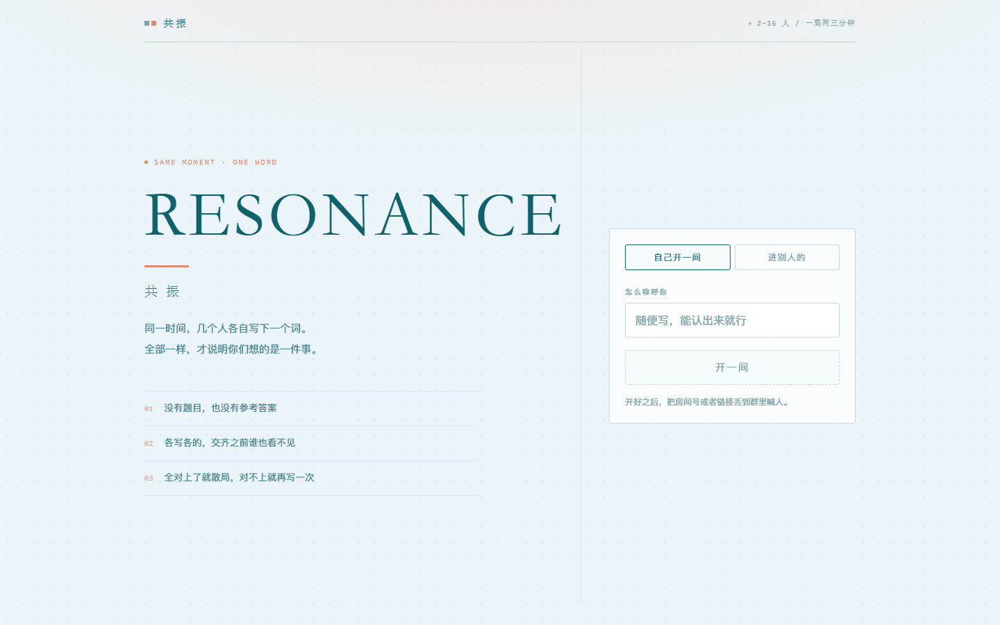
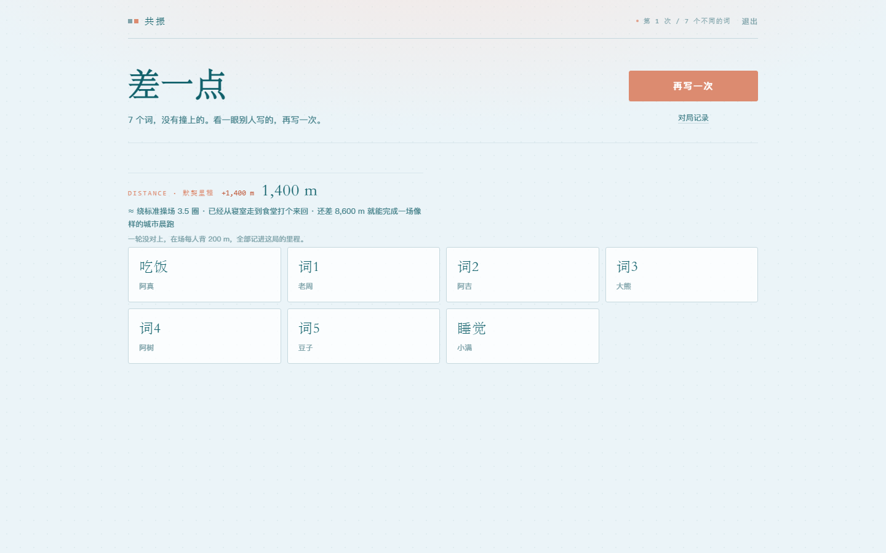
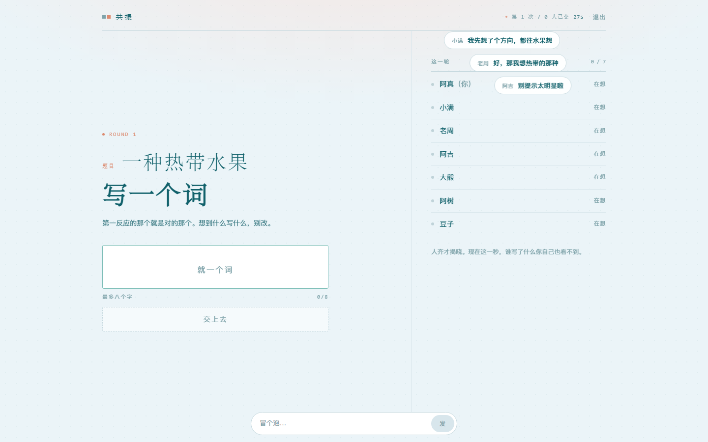
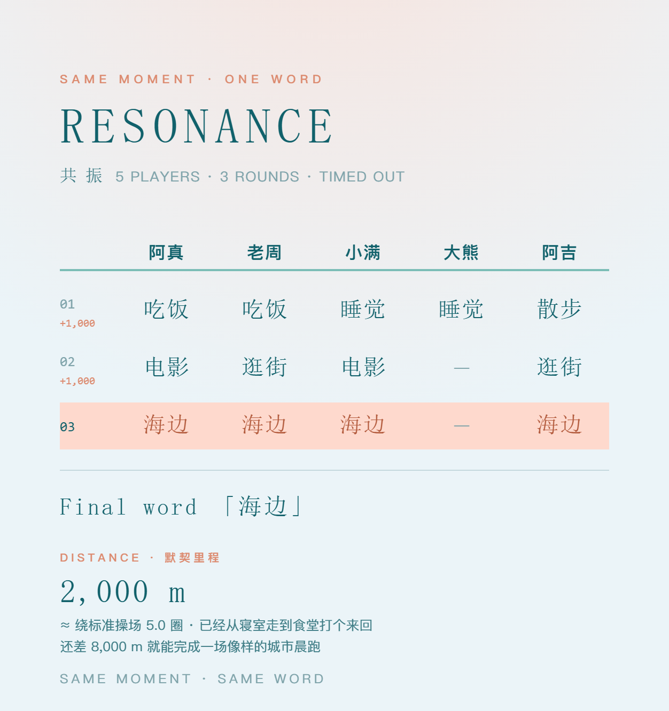
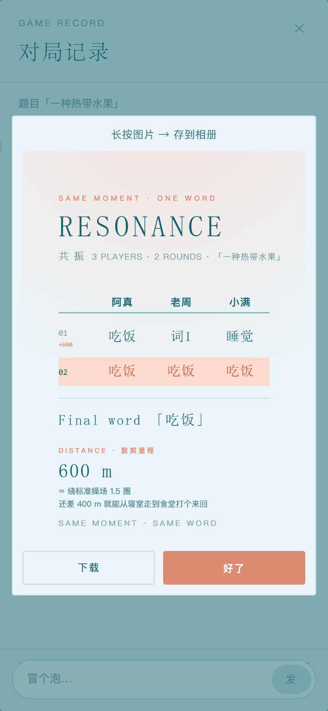

# RESONANCE · 共振

**Same moment, one word.** 同一时刻，各写一个词——全都一样，才说明你们想的是同一件事。

这是一个关于**默契**的小游戏：没有题库、没有计分、没有输赢。几个人坐进同一个房间，在同一个瞬间各自写下心里冒出来的那个词。如果所有人写的是同一个词，房间就会为你点亮——这一刻，你们真的想到了一起。

**在手机或电脑浏览器打开就能玩，无需安装：**

  <a href="https://sync-web-trh2.onrender.com/"><b>→ 开始一局共振</b></a>

---

## 怎么玩

1. **建房** —— 拿到一个 4 位房号，把邀请链接发给朋友，点开直接进房
2. **同时写** —— 每个人在输入框里写下想到的词（1–8 个字），互相看不见
3. **揭晓** —— 全员交完的瞬间，所有词按组摆开，谁写了什么一目了然
4. **再来** —— 没对上？房主点一下，马上开下一轮，直到全场共振

全一致的那一刻，就是这个游戏全部的意义。

## 它为什么好玩

**越熟的人，越容易共振。** 第一次玩可能各写各的，但玩到第五轮、第十轮，你会发现某两个人总能在没有交流的情况下写下同一个词。它把「我们有多有默契」变成了一件看得见的事——适合朋友聚会、情侣、社团破冰，也适合那些想测试一下「我们是不是心有灵犀」的人。

- **纯默契模式**：不留题目，全靠心电感应
- **出题模式**：房主丢一道题（比如「一种热带水果」），看大家会不会都想到芒果

## 默契里程

对不上没关系——**没对上的一轮，在场每个人背起 200 米**。这些米数累加成「你们这局要一起跑完的距离」，页面会告诉你它有多远：操场要绕几圈、相当于几个马拉松、够不够从上海走到北京。

默契越好，背得越少。

## 弹幕：房间里的低语

从建房那一刻起，你随时可以在底部说一句话。它不会留在聊天记录里，只会化作一条气泡，从所有人的屏幕上轻轻飘过，然后消失。

说过就散，不留痕迹——像房间里掠过的一阵风。

## 对局记录

一局结束，可以翻开完整记录：每一轮、每个人、每个词，整整齐齐一张矩阵。可以复制成文字发到群里，也可以存成一张图——

- **电脑**上直接下载到本地
- **手机**（包括微信里打开）长按图片存到相册

## 亮点一览

- 🎯 **无题库无计分** —— 唯一的胜负是「全员一致」
- 🔗 **一条链接进房** —— `?r=房号`，点开即入座
- 🔄 **刷新不丢座** —— 掉线 90 秒内回来，还坐原位
- 📏 **默契里程** —— 把默契量化成一段要一起跑完的路
- 💬 **即飘即散的弹幕** —— 不留历史，不打扰版面
- 🖼️ **一键生成记录图** —— 人是列、轮次是行，发群里正合适
- 📱 **手机电脑都好用** —— 窄屏自动回落单栏，微信内打开也能玩
- 🪶 **轻** —— 没有数据库，一个进程撑起整个房间

## 适合谁

朋友聚会冷场的时候 · 线上团建的开场 · 情侣之间的小实验 · 社团破冰的第三个小游戏 · 或者只是想确认一下，那个人是不是真的懂你。

---

  <b>2–16 人 · 4 位房号 · 一直填到全都一样为止</b>

想看实现细节？请翻 <a href="TECHNICAL.md">TECHNICAL.md</a>（架构、部署、统计与测试）

